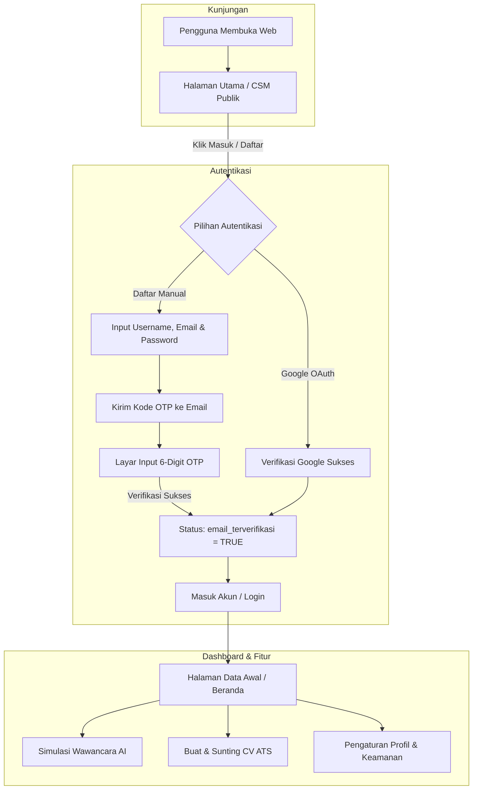

# MeIntervUAI

Platform terintegrasi untuk simulasi wawancara kerja berbasis AI (*AI Job Interview Simulation*), pembuat CV ramah ATS (*ATS CV Builder*), dan sistem layanan pelanggan / *Customer Success Management* (CSM).

---

## 📌 Ringkasan Aplikasi

MeIntervUAI dirancang untuk membantu para pencari kerja (job seekers) dan profesional dalam mempersiapkan diri menghadapi tahapan wawancara kerja, mengoptimalkan dokumen lamaran (CV), serta memperoleh panduan karir langsung melalui interaksi cerdas.

### Fitur Utama:
1. **Simulasi Wawancara Kerja AI Adaptif (Engine Karakter Bina)**: Latihan tanya-jawab wawancara adaptif berbasis data CV konkret, 6 tahapan dialog progresif, metodologi STAR/CAR, probing mendalam tanpa klise bot AI, dan aturan tegas 1 pertanyaan per giliran.
2. **3 Format Mode Wawancara Interaktif**:
   - *Teks Interaktif* (10 Token): Tanya jawab cepat berbasis teks dengan verifikasi substansi jawaban.
   - *Suara / Audio AI* (15 Token): Interaksi vokal bilingual real-time berbasis Fish Audio Cloud API & Edge-TTS neural Brian.
   - *Video & Telemetri Bahasa Tubuh MediaPipe* (25 Token): Simulasi tatap muka split-view 58%:42% desktop dan mobile-first, avatar eksekutif Bina, webcam PiP dengan overlay skeleton MediaPipe real-time (18 FPS), 4 telemetri (Kontak Mata %, Postur, Artikulasi Bibir, Gestur Tangan), serta Inline AI Vision Alert Card.
3. **Laporan Evaluasi Simulasi Wawancara (Post-Interview Scorecard)**: Scorecard komprehensif pasca-sesi dengan Bento Grid 3 Kolom (Circular Ring Gauge 84/100, 4 Pilar Metrik CAR/Komunikasi/Teknis/MediaPipe, Ringkasan Eksekutif Bina), Accordion Per Pertanyaan dengan komparasi Kekuatan vs Catatan Kritis bertanda waktu, rekomendasi jawaban ideal STAR/CAR, serta ekspor PDF terformat rapi.
4. **Pembuat CV ATS (ATS CV Builder)**: Pembuatan resume profesional yang terstandarisasi dan ramah sistem ATS (*Applicant Tracking System*) dengan 6 pilihan template formal.
5. **Sistem Token & Buku Besar Transaksi**: Transaksi saldo aman dengan audit mutasi atomik di `transaksi_token` dan pencegahan pemotongan saldo prematur (*zero orphan deduction*).
6. **Portal CSM & Dukungan Publik**: Halaman pusat bantuan terpadu (FAQ interaktif, pengajuan tiket kendala publik, dan live assistance).
7. **Keamanan Autentikasi Modern**:
   - Pendaftaran akun dengan verifikasi **OTP 6-digit email** (hitung mundur 30 detik).
   - Masuk cepat menggunakan **Google OAuth**.
   - Penomoran ID pengguna urut terstruktur (`userYYYYMMDD0000`).
8. **Dukungan Dwibahasa Simetris (i18n)**: Antarmuka multibahasa (Bahasa Indonesia & English) tanpa string hardcoded.
9. **Mobile-First & Responsif Multi-Device**: Desain UI adaptif di semua resolusi perangkat (320px s.d 1920px).


---

## 🔄 Alur Kerja Aplikasi (Application Flow)



### 1. Alur Registrasi & Autentikasi
- **Pendaftaran Akun Baru**:
  - Calon pengguna mengisi nama pengguna, email, dan kata sandi.
  - Sistem membuat akun dan mengirimkan kode OTP 6-digit ke email penerima.
  - Pengguna memasukkan kode OTP di layar verifikasi dengan proteksi *anti-bruteforce* & *countdown timer* 30 detik.
  - Setelah terverifikasi, status akun menjadi aktif dan pengguna diarahkan untuk masuk.
- **Login Google OAuth**:
  - Pengguna masuk secara instan via akun Google tanpa perlu verifikasi email manual.

### 2. Alur Penggunaan Platform
- Setelah login, pengguna diarahkan ke dasbor **Beranda**:
  - Pengisian identitas & data awal karir.
  - Memilih peran/pekerjaan impian untuk memulai simulasi wawancara kerja AI.
  - Memantau riwayat simulasi dan nilai performa jawaban.
  - Membuat dan mengekspor CV ATS-friendly.

---

## 🏗 Arsitektur Sistem

Aplikasi ini menggunakan model arsitektur terpisah (*decoupled frontend & backend*):

- **Frontend**: React 19 (TypeScript) + Vite, Tailwind CSS v4, MediaPipe Tasks Vision (`@mediapipe/tasks-vision` via Google official CDN), Lucide Icons, html2pdf.js.
- **Backend API**: Python FastAPI + Uvicorn, SlowAPI (Rate Limiter), Pydantic v2, Bina Cognitive Engine (Cohere Command-R7B + Google Gemini 3.1 Flash Lite fallback), Fish Audio Cloud API & Microsoft Edge-TTS Brian Multilingual.
- **Database & Auth**: PostgreSQL via Supabase Database (Auth, `pengguna`, `profil_pengguna`, `saldo_token`, `transaksi_token`, `cv_pengguna`, `tiket_bantuan_csm`).
- **Proxy**: Vite Dev Server mem-proxy request `/api` langsung ke gateway FastAPI.


---

## 🚀 Panduan Menjalankan Proyek

### 1. Prasyarat Sistem
- **Node.js** (v18 atau lebih baru)
- **Python** (v3.10 atau lebih baru)
- Akun & project **Supabase** (URL & Anon/Service Key)

---

### 2. Konfigurasi Port
Aplikasi ini dikonfigurasi pada port:
- **Frontend**: `http://localhost:6825`
- **Backend API**: `http://localhost:8609`

---

### 3. Menjalankan Backend (FastAPI)

1. Buka terminal dan masuk ke folder `backend`:
   ```powershell
   cd backend
   ```
2. Jalankan server FastAPI menggunakan uvicorn di port **8609**:
   ```powershell
   & "C:\Users\agil\AppData\Local\Programs\Python\Python314\python.exe" -m uvicorn app.main:app --reload --port 8609
   ```
   *(Atau `uvicorn app.main:app --reload --port 8609` jika python/uvicorn sudah terdaftar di PATH).*

3. Cek kesehatan backend di browser:
   - Gateway: [http://localhost:8609/](http://localhost:8609/)
   - Cek Kesehatan: [http://localhost:8609/api/kesehatan](http://localhost:8609/api/kesehatan)
   - Dokumentasi Swagger API: [http://localhost:8609/docs](http://localhost:8609/docs)

---

### 4. Menjalankan Frontend (React + Vite)

1. Buka terminal baru dan masuk ke folder `frontend`:
   ```powershell
   cd frontend
   ```
2. Pastikan dependencies telah terpasang:
   ```powershell
   npm install
   ```
3. Jalankan development server:
   ```powershell
   npm run dev
   ```
4. Buka aplikasi di browser:
   👉 **[http://localhost:6825](http://localhost:6825)**

---

## 📁 Struktur Direktori

```
MeIntervUAI/
├── docs/                         # Dokumentasi arsitektur, standar coding & riset HR
│   ├── README.md                 # Indeks aturan antislop & panduan dokumen
│   ├── backend.md                # Standar backend BE-01 s.d BE-06 (Bina Engine, Audio, Token Rate)
│   ├── frontend.md               # Standar frontend FE-01 s.d FE-10 (Vision Hook, Video Room, Scorecard)
│   ├── ui-ux.md                  # Standar UI/UX UX-01 s.d UX-20 (Studio Video, Telemetri, Scorecard)
│   ├── database.md               # Standar basis data DB-01 s.d DB-07 (Audit Buku Besar Mutasi Saldo)
│   └── research/                 # Riset praktisi HR & panduan wawancara adaptif
├── backend/                      # Layanan API FastAPI
│   ├── app/
│   │   ├── main.py               # Entry point FastAPI, CORS & router
│   │   ├── config.py             # Pengaturan env & rate limits
│   │   ├── routers/              # Endpoint auth, csm, profil, pengaturan, cv, simulasi
│   │   └── services/             # Supabase service, bina_service.py (Otak Bina), audio_service.py
│   ├── tests/                    # Pengujian unit otomatis (pytest)
│   └── requirements.txt          # Daftar pustaka Python
├── frontend/                     # Antarmuka Pengguna (React + Vite)
│   ├── src/
│   │   ├── pages/                # Halaman aplikasi (Auth, CSM, Beranda, Pengaturan, cv, simulasi)
│   │   │   ├── cv/               # CVBuilder & komponen editor/pratinjau ATS
│   │   │   └── simulasi/         # SimulasiWawancara, hooks (usePostureAnalysis), komponen (VideoRoomDedicated, LaporanEvaluasiWawancara)
│   │   ├── components/           # Komponen UI terstandardisasi (Tombol, Input, Modal, NotifikasiToast)
│   │   ├── i18n/                 # Lokalisasi multi-bahasa simetris (ID & EN)
│   │   └── services/             # Klien Supabase & pemanggil API backend
│   └── vite.config.ts            # Konfigurasi port dev (6825) & proxy backend (8609)
└── README.md                     # Dokumentasi utama proyek
```

---

## 🛡️ Standar Kualitas & Keamanan
- **Rate Limiting**: Perlindungan terhadap spam OTP & serangan brute force pada semua endpoint autentikasi menggunakan SlowAPI.
- **Sanitasi Input**: Validasi schema yang ketat menggunakan Pydantic di backend dan skema tipe TypeScript di frontend.
- **Desain Bebas Slop**: Mengikuti pedoman desain elegan, kontras warna yang nyaman, serta pengalaman pengguna yang intuitif di perangkat mobile maupun desktop.
