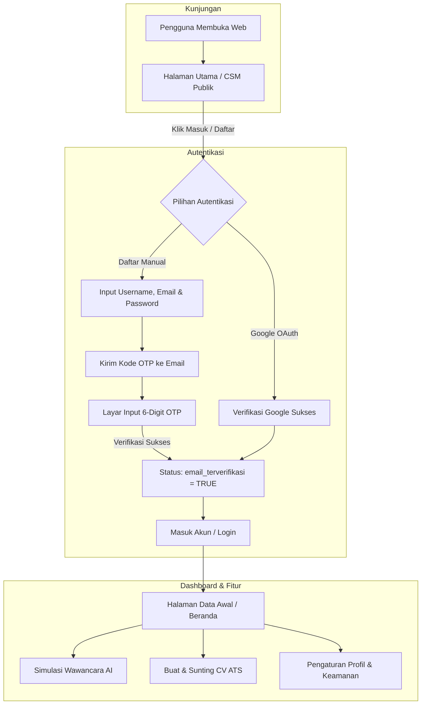

# MeIntervUAI

Platform terintegrasi untuk simulasi wawancara kerja berbasis AI (*AI Job Interview Simulation*), pembuat CV ramah ATS (*ATS CV Builder*), dan sistem layanan pelanggan / *Customer Success Management* (CSM).

---

## 📌 Ringkasan Aplikasi

MeIntervUAI dirancang untuk membantu para pencari kerja (job seekers) dan profesional dalam mempersiapkan diri menghadapi tahapan wawancara kerja, mengoptimalkan dokumen lamaran (CV), serta memperoleh panduan karir langsung melalui interaksi cerdas.

### Fitur Utama:
1. **Simulasi Wawancara Kerja AI**: Latihan tanya-jawab wawancara interaktif berbasis posisi kerja dan industri, lengkap dengan umpan balik instan.
2. **Pembuat CV ATS (ATS CV Builder)**: Pembuatan resume profesional yang terstandarisasi dan ramah sistem ATS (*Applicant Tracking System*).
3. **Portal CSM & Dukungan Publik**: Halaman pusat bantuan terpadu (FAQ interaktif, pengajuan tiket kendala publik, dan live assistance).
4. **Keamanan Autentikasi Modern**:
   - Pendaftaran akun dengan verifikasi **OTP 6-digit email** (hitung mundur 30 detik).
   - Masuk cepat menggunakan **Google OAuth**.
   - Penomoran ID pengguna urut terstruktur (`userYYYYMMDD0000`).
5. **Dukungan Dwibahasa (i18n)**: Antarmuka multibahasa (Bahasa Indonesia & English).
6. **Mobile-First & Responsif**: Desain UI adaptif di semua resolusi perangkat (HP, tablet, desktop).

---

## 🔄 Alur Kerja Aplikasi (Application Flow)



### 1. Alur Registrasi & Autentikasi
- **Pendaftaran Akun Baru**:
  - Calon pengguna mengisi nama pengguna, email, dan kata sandi.
  - Sistem membuat akun dan mengirimkan kode OTP 6-digit ke email penerima.
  - Pengguna memasukkan kode OTP di layar verifikasi dengan proteksi *anti-bruteforce* & *countdown timer* 30 detik.
  - Setelah terverifikasi, status akun menjadi aktif dan pengguna diarahkan untuk masuk.
- **Login Google OAuth**:
  - Pengguna masuk secara instan via akun Google tanpa perlu verifikasi email manual.

### 2. Alur Penggunaan Platform
- Setelah login, pengguna diarahkan ke dasbor **Beranda**:
  - Pengisian identitas & data awal karir.
  - Memilih peran/pekerjaan impian untuk memulai simulasi wawancara kerja AI.
  - Memantau riwayat simulasi dan nilai performa jawaban.
  - Membuat dan mengekspor CV ATS-friendly.

---

## 🏗 Arsitektur Sistem

Aplikasi ini menggunakan model arsitektur terpisah (*decoupled frontend & backend*):

- **Frontend**: React (TypeScript) + Vite, Desain Token Vanilla CSS, Lucide Icons.
- **Backend API**: Python FastAPI + Uvicorn, SlowAPI (Rate Limiter), Pydantic v2.
- **Database & Auth**: PostgreSQL via Supabase Database & Supabase Auth.
- **Proxy**: Vite Dev Server mem-proxy request `/api` langsung ke gateway FastAPI.

---

## 🚀 Panduan Menjalankan Proyek

### 1. Prasyarat Sistem
- **Node.js** (v18 atau lebih baru)
- **Python** (v3.10 atau lebih baru)
- Akun & project **Supabase** (URL & Anon/Service Key)

---

### 2. Konfigurasi Port
Aplikasi ini dikonfigurasi pada port:
- **Frontend**: `http://localhost:6825`
- **Backend API**: `http://localhost:8609`

---

### 3. Menjalankan Backend (FastAPI)

1. Buka terminal dan masuk ke folder `backend`:
   ```powershell
   cd backend
   ```
2. Jalankan server FastAPI menggunakan uvicorn di port **8609**:
   ```powershell
   & "C:\Users\agil\AppData\Local\Programs\Python\Python314\python.exe" -m uvicorn app.main:app --reload --port 8609
   ```
   *(Atau `uvicorn app.main:app --reload --port 8609` jika python/uvicorn sudah terdaftar di PATH).*

3. Cek kesehatan backend di browser:
   - Gateway: [http://localhost:8609/](http://localhost:8609/)
   - Cek Kesehatan: [http://localhost:8609/api/kesehatan](http://localhost:8609/api/kesehatan)
   - Dokumentasi Swagger API: [http://localhost:8609/docs](http://localhost:8609/docs)

---

### 4. Menjalankan Frontend (React + Vite)

1. Buka terminal baru dan masuk ke folder `frontend`:
   ```powershell
   cd frontend
   ```
2. Pastikan dependencies telah terpasang:
   ```powershell
   npm install
   ```
3. Jalankan development server:
   ```powershell
   npm run dev
   ```
4. Buka aplikasi di browser:
   👉 **[http://localhost:6825](http://localhost:6825)**

---

## 📁 Struktur Direktori

```
MeIntervUAI/
├── docs/                         # Dokumentasi arsitektur, standar coding & ADR
│   ├── README.md                 # Indeks aturan antislop & panduan dokumen
│   ├── adr-auth-otp.md           # ADR-001: Alur autentikasi, verifikasi OTP & ID
│   ├── backend.md                # Standar backend & rate limiting
│   ├── frontend.md               # Standar frontend & arsitektur komponen
│   ├── ui-ux.md                  # Standar UI/UX, tema & mobile-first
│   └── database.md               # Skema data & standar ID terstruktur
├── backend/                      # Layanan API FastAPI
│   ├── app/
│   │   ├── main.py               # Entry point FastAPI, CORS & router
│   │   ├── config.py             # Pengaturan env & rate limits
│   │   ├── routers/              # Endpoint auth, csm, profil, pengaturan
│   │   └── services/             # Supabase service & ID generator
│   └── requirements.txt          # Daftar pustaka Python
├── frontend/                     # Antarmuka Pengguna (React + Vite)
│   ├── src/
│   │   ├── pages/                # Halaman aplikasi (Auth, CSM, Beranda, Pengaturan)
│   │   ├── components/           # Komponen UI terstandardisasi (Tombol, Input, Modal)
│   │   ├── i18n/                 # Lokalisasi multi-bahasa (ID & EN)
│   │   └── services/             # Klien Supabase & pemanggil API backend
│   └── vite.config.ts            # Konfigurasi port dev (6825) & proxy backend (8609)
└── README.md                     # Dokumentasi utama proyek
```

---

## 🛡️ Standar Kualitas & Keamanan
- **Rate Limiting**: Perlindungan terhadap spam OTP & serangan brute force pada semua endpoint autentikasi menggunakan SlowAPI.
- **Sanitasi Input**: Validasi schema yang ketat menggunakan Pydantic di backend dan skema tipe TypeScript di frontend.
- **Desain Bebas Slop**: Mengikuti pedoman desain elegan, kontras warna yang nyaman, serta pengalaman pengguna yang intuitif di perangkat mobile maupun desktop.
